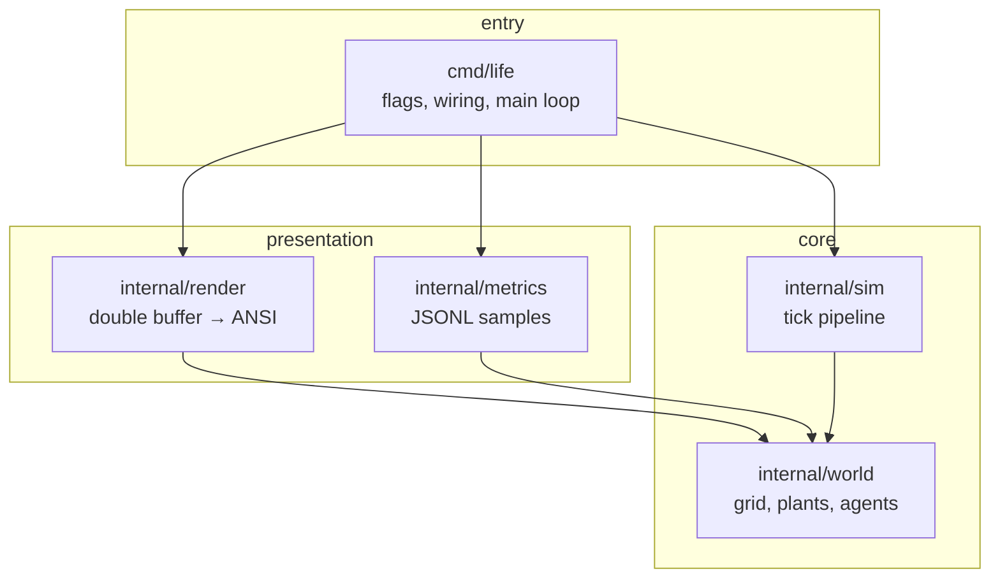

# Terminal Life — Architecture

Companion to [DESIGN.md](DESIGN.md). This file covers *how the code is organised*, not *what the simulation does*.

---

## 1. Shape of the program

One binary, one process, one goroutine, three layers with a strict dependency direction:



**Dependency rule (enforced by package boundaries, reviewed by hand):**

- `world` imports only the standard library. It knows nothing about ticks, rendering, or output.
- `sim` imports `world`. It owns the tick pipeline and is the only package that mutates agent state.
- `render` and `metrics` import `world` **read-only**. They must not mutate.
- `cmd/life` imports everything and is the only place that does I/O, flag parsing, and the frame clock.

This keeps the simulation headless-testable: `sim` + `world` can run 100,000 ticks with no terminal attached.

## 2. Directory layout

```
terminal-life/
├── cmd/
│   └── life/
│       └── main.go          # flags → World → loop { Step; Render } → metrics flush
├── internal/
│   ├── world/
│   │   ├── world.go         # World struct, grid, NewWorld(seed, params)
│   │   ├── plant.go         # plant growth, grazing, corpse decay
│   │   └── agent.go         # Agent struct, Genome, mutation
│   ├── sim/
│   │   ├── step.go          # the 8-stage tick pipeline
│   │   └── step_test.go     # invariants, determinism, energy balance
│   ├── render/
│   │   ├── ansi.go          # buffer diffing, escape sequences, palette
│   │   └── ansi_test.go     # golden frames (no escape codes when piped)
│   └── metrics/
│       ├── metrics.go       # Sample struct, JSONL writer
│       └── metrics_test.go  # stable field order, %.4f formatting
├── docs/
│   ├── DESIGN.md
│   ├── ARCHITECTURE.md
│   ├── ROADMAP.md
│   └── HANDOFF.md
├── go.mod                   # module github.com/doogev/terminal-life
└── LICENSE
```

Go version: whatever is current on the dev machine; standard library only, so no toolchain pinning games.

## 3. Core types

```go
// internal/world
type Params struct {
    W, H             int
    SunRate          float32
    MaxPlantEnergy   float32
    BaseCost         float32
    SpeedCost        float32
    Bite             float32
    TransferEfficiency float32
    ReproCost        float32
    MaxAge           int
    MetricsEvery     int
}

type Genome struct {
    Speed  int8   // 1..3
    Vision int8   // 1..12
    Repro  int16  // 40..160
}

type Agent struct {
    X, Y   int
    Energy float32
    Age    int
    G      Genome
    Kind   Kind   // Herbivore | Predator
}

type World struct {
    P      Params
    Plants []float32 // W*H
    Agents []Agent   // stable order; compacted after each tick
    RNG    *rand.Rand
    Tick   int
}
```

`Agents` is a slice rather than a grid-resident structure for two reasons: iteration order must be stable for determinism, and several agents can transiently occupy one cell, which is easier to resolve in a slice pass than in a grid.

## 4. Tick data flow

```
        ┌─────────────┐
        │  cmd/life   │  frame clock (--fps), Ctrl-C handling
        └──────┬──────┘
               │ Step(w)
   ┌───────────▼─────────────────────────────────────────────┐
   │ internal/sim                                            │
   │  1 sunlight   → world.GrowPlants()                      │
   │  2 sense      → per agent: nearest food (Chebyshev)     │
   │  3 move       → clamp to bounds                         │
   │  4 feed       → world.Graze() / world.Prey()            │
   │  5 metabolise → Energy -= cost; Age++                   │
   │  6 reproduce  → append child (slot reuse after tick)    │
   │  7 die        → mark → compact                          │
   │  8 sample     → metrics.Take(w)                         │
   └───────────┬─────────────────────────────────────────────┘
               │ read-only
      ┌────────▼────────┐        ┌──────────────────┐
      │ render.ANSI     │        │ metrics.JSONL    │
      │ chars+colors    │        │ one line / N tick│
      └─────────────────┘        └──────────────────┘
```

### Mutation discipline

Only `sim.Step` mutates agents. `render` and `metrics` receive `*World` but must treat it as read-only — a lint pass or a code review note, since Go has no `const` receiver. If a renderer needs derived data (e.g. plant colour ramps), it computes it into its own buffer, never back into the world.

## 5. Rendering strategy

```go
type Frame struct {
    Chars  []rune
    Colors []uint8
    W, H   int
}
```

- Two `Frame`s exist: `cur` (written by the renderer) and `prev` (last sent to the terminal).
- Each tick: renderer fills `cur` from the world, then emits only the rows that differ, using `\x1b[<row>;1H` per changed row.
- Full-frame emission is the fallback; the row-diff is ~15 lines of code and saves the flicker on slow terminals.
- Colour: 256-colour SGR (`\x1b[38;5;Nm`), palette constants in `ansi.go`, no external theme file.
- If `os.Stdout` is not a TTY, `render` is not constructed at all and `--headless` behaviour applies automatically.

## 6. Performance budget

Targets on a 4-core / 4 GB CPU-only box, single-threaded:

| Stage | Budget @ 200 agents, 7,200 cells | Notes |
| --- | --- | --- |
| Plant growth | < 0.1 ms | One pass over 7,200 float32 |
| Sensing | < 0.5 ms | Brute force 200² = 40 k Chebyshev checks |
| Move + feed | < 0.1 ms | O(agents) |
| Metrics | amortised | One JSON line per 100 ticks |
| Render | < 3 ms | 7,200 cells + row serialisation |
| **Frame total** | **< 5 ms** | Leaves headroom for 60 FPS |

Escalation path if sensing blows the budget above ~1,000 agents: bucketed spatial hash (fixed cell size = max vision), not a quadtree — simpler, and the world is small.

## 7. Testing strategy

Three test tiers, all runnable with `go test ./...`:

1. **Invariant tests** (`sim`): energy never negative; agent count never exceeds a configured cap; no agent outside bounds after a step.
2. **Determinism test**: two 10 k-tick runs with the same seed produce identical metrics bytes (hash comparison).
3. **Golden frame test** (`render`): a hand-built 5×5 world renders to an exact expected string; piped output contains zero `\x1b` bytes.

No golden tests for long simulations — parameter changes would churn them constantly. Behavioural claims belong in the metrics, not in snapped frames.

## 8. Extension seams

Kept cheap on purpose, so v1.1 does not require a rewrite:

- `Kind` is an enum with room for `Omnivore`.
- `Genome` mutation is a single function, easy to extend to a second gene set.
- `Params` is passed by value into `NewWorld`, so a config file can be added without touching the core.
- Metrics writer takes an `io.Writer`, so stdout, file, and test buffers all work.
